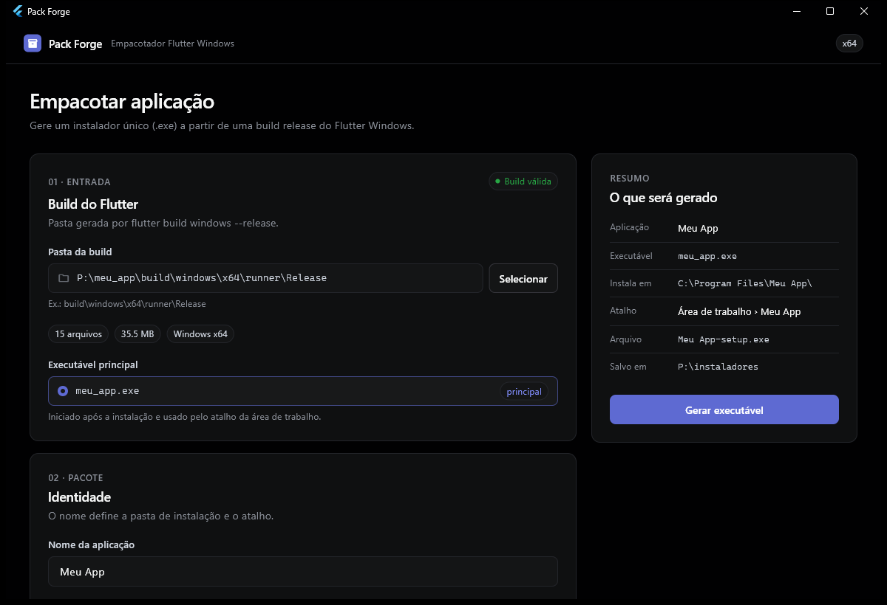
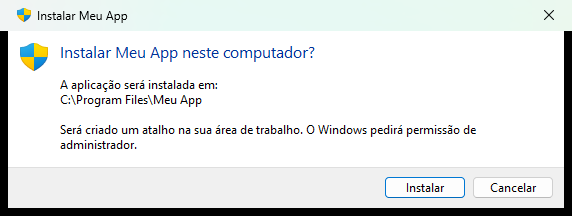
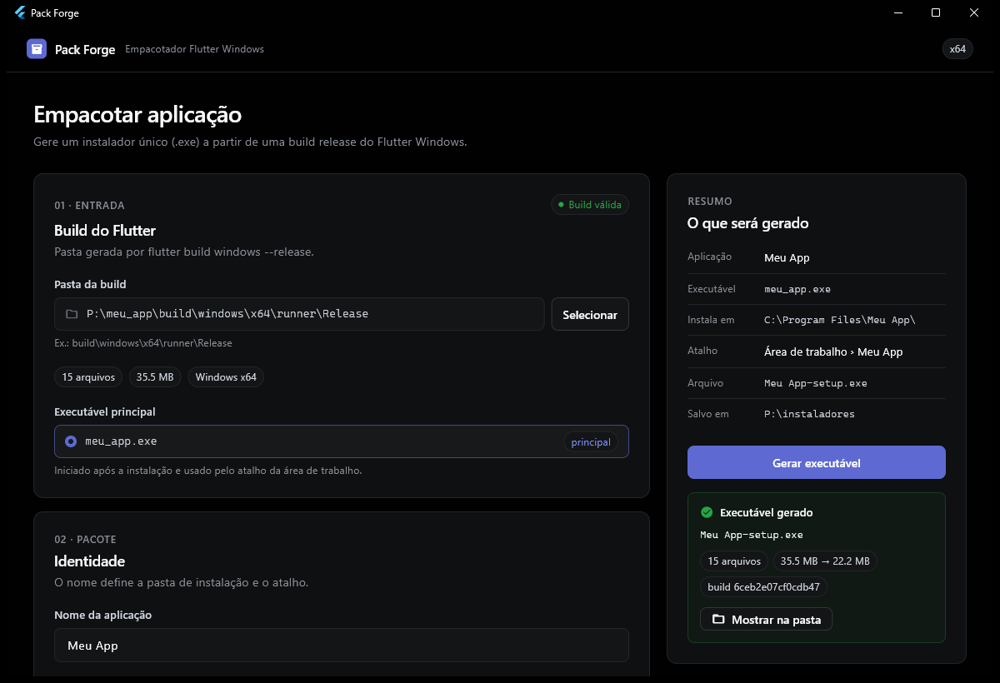

# Pack Forge

Gere um **instalador único (`.exe`)** para seus apps Flutter Windows. Sem cadastro, sem conta, sem configuração: selecione a pasta da build, clique em **Gerar executável** e pronto.



## Por que existe

O `flutter build windows --release` gera uma pasta com o executável, várias DLLs e a pasta `data`. Para entregar isso para outra pessoa, eu precisava de um instalador, e as ferramentas que encontrei pediam cadastro, scripts de configuração ou eram muito mais do que eu precisava.

O Pack Forge faz uma coisa só: transforma essa pasta em um `.exe` que instala, atualiza ou desinstala a aplicação.

## O que o instalador gerado faz

Ao abrir o `.exe` gerado no computador de destino:

- **Primeira vez:** instala em `C:\Program Files\<NomeDaAplicacao>\`, cria um atalho na área de trabalho, avisa que deu certo e abre a aplicação.
- **Já instalado:** oferece **Atualizar**, **Desinstalar** ou **Cancelar**.
- Não precisa de Flutter, Dart nem nenhuma outra instalação na máquina de destino.



## Como usar

Requisitos: Windows 10/11 x64 e Flutter com suporte a desktop Windows.

```bash
git clone <url-do-repositorio>
cd pack_forge
flutter pub get
flutter run -d windows        # ou: flutter build windows --release
```

Na interface:

1. **Entrada:** selecione a pasta da build (`build\windows\x64\runner\Release`) e confirme o executável principal.
2. **Pacote:** informe o nome da aplicação (vira a pasta de instalação e o nome do atalho) e, se quiser, um ícone `.ico`. Se a build estiver dentro do projeto, o ícone do projeto é sugerido automaticamente.
3. **Saída:** escolha o nome do arquivo e a pasta onde ele será salvo.
4. Clique em **Gerar executável**.



## Como funciona

O Pack Forge é todo em Dart e tem duas partes:

| Parte | O que faz |
|---|---|
| **Empacotador** (app Flutter) | Valida a build, comprime cada arquivo, calcula o SHA-256 e anexa tudo ao final do launcher. |
| **Launcher** (`launcher/`, Dart AOT + Win32, sem Flutter) | É o "motor" do instalador: lê o pacote anexado a si mesmo, mostra os diálogos nativos do Windows e instala, atualiza ou desinstala. |

Formato do `.exe` gerado:

```
[launcher.exe + ícone][arquivos comprimidos][manifesto JSON][trailer de 80 bytes]
```

Alguns cuidados que o instalador toma:

- **UAC só quando precisa:** apenas as operações de arquivo em `Program Files` rodam como administrador. O atalho e a abertura da aplicação rodam com o usuário atual.
- **Atualização segura:** a nova versão é extraída numa pasta temporária e conferida arquivo por arquivo antes de substituir a instalação atual. Se algo falhar, a versão anterior continua funcionando.
- **Integridade:** pacotes corrompidos são recusados antes de qualquer alteração.
- **Proteção de caminhos:** caminhos absolutos, `..` e nomes reservados do Windows são rejeitados, e só pastas do próprio instalador são removidas.
- **Aplicação aberta:** atualizar ou desinstalar com a aplicação em execução pede para fechá-la antes.

### Estrutura do código

| Caminho | Conteúdo |
|---|---|
| `lib/core/` | Formato do pacote, validação de nomes e caminhos, edição de recursos PE (compartilhado). |
| `lib/packer/` | Inspeção da build e geração do executável. |
| `lib/ui/` | Interface do empacotador. |
| `launcher/` | Código do instalador autoextrator. |
| `tool/build_launcher.dart` | Compila o launcher e o copia para `assets/launcher/`. |

### Alterando o launcher

O arquivo `assets/launcher/pack_forge_launcher.exe` é o launcher compilado que o Pack Forge usa como base de todo instalador. Depois de alterar algo em `launcher/` ou `lib/core/`, gere-o novamente:

```bash
dart run tool/build_launcher.dart
```

## Limitações

Este é um projeto simples, feito para uso pessoal e de equipe:

- O instalador **não é assinado digitalmente**: o Windows SmartScreen pode exibir um aviso ao abrir.
- Não há controle de versão: qualquer pacote com o mesmo nome de aplicação substitui a instalação existente.
- A atualização e a desinstalação **apagam a pasta de instalação inteira**. Dados salvos pela aplicação em `%APPDATA%` não são afetados.
- O runtime do Visual C++ não é incluído; a build precisa conter tudo que a aplicação usa.
- Apenas Windows x64.

## Créditos

O visual da interface foi inspirado no design system do Linear, disponível na coleção [awesome-design-md](https://github.com/voltagent/awesome-design-md).

## Licença

[MIT](LICENSE)
